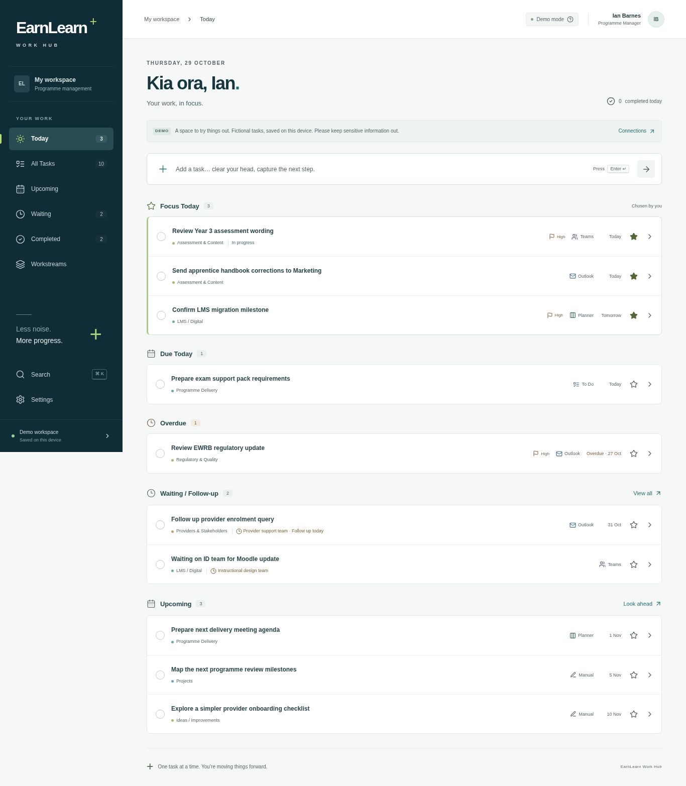

# EarnLearn Work Hub

A calm, responsive workspace for a Programme Manager’s working day. Built with React 19, TypeScript and Vite. **Stage 1 is a working demo. Stage 2 is an explicit integration scaffold, not a live Microsoft connection.**



[Task details](docs/screenshots/task-details.png) · [Mobile layout](docs/screenshots/mobile.png)

## Run it

Requires Node.js 22.12 LTS or Node 24 LTS (recommended, pinned in `.nvmrc`) and npm.

```sh
npm ci
npm run dev
```

Open the local address printed by Vite. No Microsoft credentials, backend, Teams host or `.env` file is required for the demo. This cloud environment already has an isolated checkout at `/workspace/PA`; use that checkout rather than creating a worktree.

```sh
npm run lint
npm run typecheck
npm test
npm run build
npm run preview
```

Production output is `dist/`. Preview serves that output, including the service worker. PWA installation and offline caching are available in a production build over HTTPS (or localhost). Dev mode deliberately does not install a service worker.

## What works

- **Today:** date/greeting, deliberate daily focus, due tasks, overdue tasks, waiting/follow-up and upcoming preview. Focus expires with the calendar day. The star toggles focus; quickly captured tasks enter today’s focus automatically.
- **Capture:** type a title and press Enter, then add details when ready.
- **Details:** editable title, status, priority, workstream, due date, waiting contact/date, notes, checklist, completion outcome and resource links. Use **Save changes** to retain edits. Closing without saving discards edits.
- **Completion:** row checkboxes save to the original provider, show a short completion transition, and offer Undo. Completion retains the record. Complete from the drawer to add an outcome first. Completed tasks can be reopened.
- **History:** full-text search over titles, notes, outcomes, checklist text, resource names, people and source context; workstream, source and inclusive completion-date filters.
- **Waiting:** a dedicated list with who/when/context. Due follow-ups return to Today’s attention; tasks remain waiting until explicitly changed.
- **Upcoming:** calendar-week groups, with overdue and today context; no project timeline machinery.
- **All Tasks / Search:** text, source, workstream, priority, status and due-date filters. Search includes history by default; All Tasks defaults to active records.
- **Workstreams:** add, rename and remove unused workstreams. Renaming updates active and historical tasks. Removal of used workstreams is blocked until their tasks are moved.
- **PWA:** installable icons/manifest, production shell caching, update prompt, offline status. No Graph/auth response caching.
- **Accessibility:** semantic controls, focus visibility, trapped/restored dialog focus, Escape to close, reduced motion, responsive mobile navigation and no colour-only status. `Ctrl/⌘ K` searches; `N` focuses capture outside editable controls.
- **Settings:** honest connection status, storage explanation, keyboard help and confirmed demo reset.

All seed tasks are fictional. Their dates are relative to first use/reset, so there are useful examples whenever the application is evaluated. Source labels such as Outlook and Planner represent sample provenance, not fetched Microsoft records; no fabricated “open original” links are supplied.

## Architecture

```text
src/
  App.tsx                 Navigation, workspace state and user actions
  components/             Rows, drawer, filters, workstreams, settings
  lib/model.ts            Normalized Task, patch types and capability contracts
  lib/dates.ts            Local calendar-day calculations
  lib/microsoft.ts        Explicit MSAL initialization and typed Graph v1.0 client
  providers/
    TaskHub.ts             Aggregates reads; routes writes to canonical provider
    MockTaskProvider.ts    Transactional, serialized demo operations
    MicrosoftProviders.ts Fail-closed To Do and Planner scaffolds
    storage.ts             Demo-only IndexedDB persistence
    seed.ts                Fictional examples
tests/                     Provider regression and production-browser tests
build/pwa.ts               Native static-shell service-worker generation
docs/                      Integration, hosting and visual decisions
```

The UI consumes normalized tasks through `TaskHub`. A task retains `provider`, `providerTaskId`, optional list ID and ETag. Live IDs must be namespaced for UI uniqueness while preserving Microsoft IDs unchanged for writes; never copy Planner tasks into To Do to display them.

Providers advertise writable fields. The drawer disables unsupported fields and the hub rejects unsupported patches rather than silently dropping them. The demo provider supports the complete model. Future live providers start with **no write capabilities** and throw `IntegrationNotImplementedError` on every operation until implemented and validated. Their constructors are never used by the demo.

`focusDate` deliberately represents a local daily presentation choice, rather than Microsoft Planner’s beta My Day feature. Task content belongs in Microsoft 365 when live integration is added. Workstreams, waiting metadata and outcomes need an IT-approved metadata strategy where Graph lacks equivalent fields; see the integration guide.

## Demo storage and security

Demo tasks are saved **only in this browser’s IndexedDB** so reloads preserve evaluation work. They are not synced, backed up, encrypted by this application or available on other devices. Treat the demo as disposable and do not enter confidential information. The app says this prominently. Settings can reset it; clearing site data also removes it. Task content is not put in localStorage, analytics, AI requests or production logs.

This is not an authenticated production work-data deployment. Microsoft task storage must remain separate from demo storage. The prepared MSAL client uses in-memory token caching and no client secret. A service worker caches static assets only. User resource links allow http/https only and external links use `noopener noreferrer`. Hosting headers provide CSP and other baseline protections.

## Microsoft integration

See [Microsoft 365 integration and IT handoff](docs/microsoft-integration.md) for exact delegated permissions, v1.0 endpoints, unsupported fields and release gates. `.env.example` contains **public SPA identifiers only**:

```sh
cp .env.example .env.local
# Fill in VITE_ENTRA_CLIENT_ID, VITE_ENTRA_TENANT_ID, VITE_ENTRA_REDIRECT_URI.
```

Setting these does **not** enable live mode. Settings reports their presence while continuing to state that providers are unimplemented. There is no fake sign-in button or successful connection state. MSAL Browser is prepared; `MsalProvider` from MSAL React can wrap the live app once the sign-in/account lifecycle is implemented. No Graph Toolkit or beta dependency is used.

## Deployment and Teams

See [Azure and Teams deployment](docs/deployment.md). The same static build can later be hosted as a Teams personal tab; normal browser use has no Teams dependency. No live Azure resource or public deployment has been created by this repository.

## Validation

```sh
npm run check                 # lint, typecheck, 8 provider/domain tests, production build
npx playwright install chromium
npm run test:e2e              # production build must already exist
```

With a preinstalled browser (as in this cloud environment):

```sh
PLAYWRIGHT_CHROMIUM_EXECUTABLE_PATH=/usr/bin/chromium npm run test:e2e
```

The browser suite exercises capture/edit/complete/reopen and persistence, waiting follow-ups, workstream filtering, undo, unsafe-link rejection, dialog keyboard focus, desktop/mobile accessibility scans and a real offline PWA reload. Tests use isolated browser contexts and fictional data. Browser tests use the Pacific/Auckland timezone. Test reports and screenshots are generated under ignored `playwright-report/` and `test-results/`.

Automated accessibility checks are a baseline, not a claim of full WCAG conformance. Manual screen-reader checks, actual Edge/Surface testing and organisational security review remain release checks for a live deployment.

## Design reference

The supplied **EL 4204 – Electrical Apprentice Handbook (digital), September 2026**, cover and contents page were visually inspected. See [design decisions](docs/design.md). CSS tokens are provisional interpretations, not official corporate hex values. The wordmark is typographic placeholder branding pending approved assets; the supplied PDF is not redistributed in this repository.
