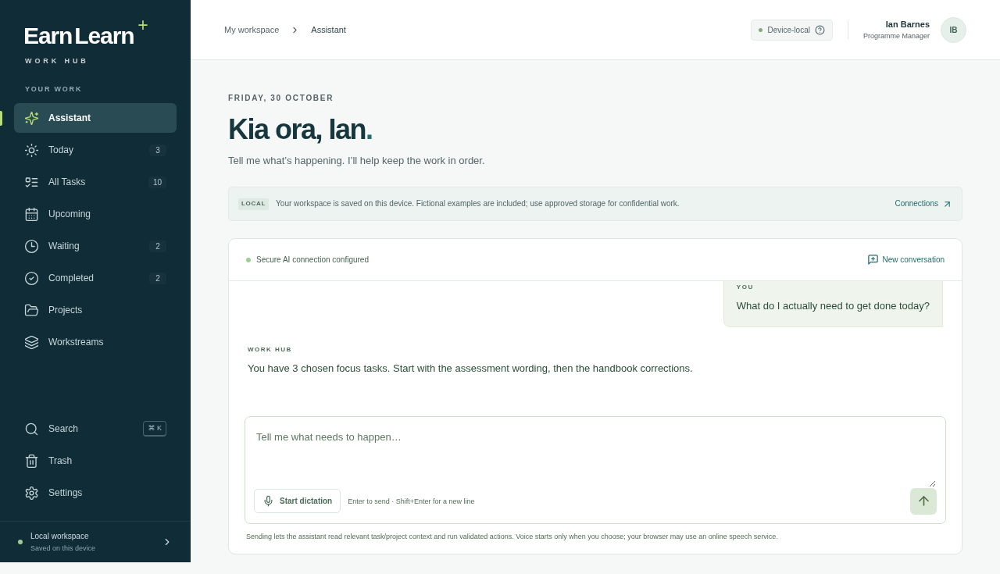

# EarnLearn Work Hub

A personal AI management assistant for a Programme Manager. **Assistant is the primary home**: speak or type naturally, let the assistant use controlled application tools, then see confirmed changes in Today, tasks, projects and retained work history.

This evolves the existing React/TypeScript/Vite application. The task UI, provider abstraction, IndexedDB data, voice support, PWA and secure server adapters are retained. [Audit and implementation decisions](docs/assistant-evolution-audit.md).



The example conversation above uses controlled responses from the local browser tests. A live AI connection still requires the securely configured server.

[Today](docs/screenshots/today.png) · [Task details](docs/screenshots/task-details.png) · [Mobile assistant](docs/screenshots/assistant-mobile.png)

## Run locally

Node 24 is recommended (`.nvmrc`). Use the existing isolated checkout; do not create a worktree unless explicitly requested.

```sh
npm ci
npm ci --prefix api
npm run dev
```

Manual task controls and stored project/history views work without AI credentials. For the embedded assistant, supply `WORK_HUB_AI_KEY` securely to the **server process**, or create the ignored `.env.server` from `.env.server.example` and fill it locally. Never put a real key in chat, a `VITE_` variable, the HTML download or a commit. In another terminal:

```sh
npm run ai:server
```

The Node adapter binds to loopback 8787; Vite proxies `/api/assistant` to it. `WORK_HUB_AI_MODEL` selects a Responses/function-calling model (default `gpt-5-mini`; verify availability in the authorised project). Restart the adapter after changing injected configuration. OpenAI API usage has separate billing from ChatGPT subscriptions.

No Azure resource is needed for local development. No live key or deployment identity is supplied by this repository. Missing configuration is reported honestly; there is no simulated AI or external ChatGPT copy/import workflow.

## Normal interaction

- “Review the Moodle questions next week, but it’s not urgent.” → create a persisted task, scheduling an explicit/default day and setting low priority.
- “I’ve finished the Logan thing.” → look up the real task, clarify if needed, complete it and retain its notes/outcome.
- “Move that review to Monday.” → use the conversation’s recent record reference and current revision to reschedule the same task.
- “Check with Prakash before we do anything else.” → retain the person/context and waiting/follow-up state where appropriate.
- “What do I actually need to get done today?” / “I’ve got too much on.” → read current workspace records and give a practical focus order.
- “Create a Launchpad project and keep the marketing work together.” → persist a project with context and link its tasks.

The model handles language and intent. There is no regex-based pretend AI. Ambiguous records or materially unknown meeting dates require a concise clarification. Ordinary clear actions execute directly; forms are secondary. Confirmed action cards come from actual tool results, separately from the model’s prose.

Browser dictation starts only when selected and may use the browser vendor’s online speech service. Type or use Windows dictation (`Win+H`) if unavailable. A real microphone/model response is not claimed merely because fixture-based tests pass.

## Database is the source of truth

The existing device-local IndexedDB is retained: `earnlearn-demo-v1` / `workspace` / `demo`. The snapshot evolves lazily to version 2 without replacing task IDs, provider task IDs, notes, checklist, completions or source context. Former mock records become application-local records; external Microsoft identifiers are not rewritten.

Persisted independently of conversation text:

- tasks, project links, due/follow-up/focus dates, priority, status, notes, checklist, resources and outcome;
- projects with name, notes, workstream, status, dates and revisions;
- recoverable Trash and action history;
- revisions and durable action receipts that prevent retries creating duplicates.

Conversation and interrupted-turn checkpoints are stored separately in the same snapshot. **New conversation never deletes task/project records.** A failed final model response can be resumed without repeating already committed actions. An interrupted request can also be stopped while retaining confirmed changes.

Writes are queued, durable and revision checked. Local writes re-read the database, and browsers supporting Web Locks serialize writes across tabs. Other adapters can implement `WorkspaceStorage`; device-local storage is **not** a shared server database, multi-device sync or an organisational backup. Use one browser profile per person. Settings can download a readable JSON backup of records/history, excluding conversation state and credentials.

The new source-of-truth principle supersedes the original Microsoft-first storage goal for this iteration. To Do/Planner provider scaffolds are retained, remain disabled, and are never described as live sync. [Historical Microsoft integration roadmap](docs/microsoft-integration.md).

## Controlled AI action layer

`server/chat.ts` uses OpenAI **Responses API function calling** with strict JSON schemas, explicit function-call outputs, `store: false`, and preserved reasoning continuation items for multi-step turns. The key stays server-side. `AssistantEngine` orchestrates bounded tool rounds; `ActionRuntime` validates arguments and executes whitelisted functions against the workspace. The AI has no SQL, eval, filesystem, mail-sending or arbitrary database tool.

Supported tools:

- `create_task`, `update_task`, `complete_task`, `reopen_task`, `delete_task`, `restore_task`
- `add_task_note`, `reschedule_task`, `set_task_priority`, `assign_task_project`
- `get_task`, `search_tasks`, `get_today_tasks`, `get_upcoming_tasks`, `get_overdue_tasks`, `get_waiting_tasks`, `get_completed_tasks`
- `create_project`, `update_project`, `get_project_context`, `search_projects`

Zod schemas are shared between server tool definitions and application validation. Writes require real records and fresh revisions. Ambiguous search results block arbitrary selection in that turn. Repeated tool/action IDs and identical same-turn mutations reuse receipts. Deletion is recoverable; restoring a completed task keeps its completion history. No model statement alone can change the database.

Only the conversation, current calendar/workstream context, recent record references and records explicitly requested by tools are sent to the configured API. The whole task database is not uploaded on each message. Stored titles/notes/tool output are treated as data, not privileged instructions. No analytics or AI transcript/token logging is added.

## Existing task UI remains useful

Today, All Tasks, Upcoming, Waiting, Completed, Workstreams, search/filtering, task details, notes, checklists, safe resource links, completion undo and daily focus remain. Projects and Trash are now first-class views. Manual edits are revision checked, and manual delete/restore still work without AI.

The interface is responsive, keyboard operable, reduced-motion aware and automatically scanned with axe. The name and refined EarnLearn placeholder branding are retained. Brand tokens need validation against official assets; [design reference](docs/design.md).

## Structure

```text
src/assistant/        Tool schemas, runtime, conversation engine and contracts
src/providers/        Existing provider layer plus WorkspaceProvider/IndexedDB
src/components/       Embedded conversation, task/detail/filter/project views
src/lib/              Task/project model, local calendar dates, speech, MSAL scaffold
server/               Loopback API, server-side Responses orchestration
api/                  Role-protected Azure managed Functions adapter
build/                Static-shell PWA generation
scripts/              Portable single-file build
tests/               Domain, transport, recovery and browser tests
```

## Validation

```sh
npm run check
npm run build --prefix api
npx playwright install chromium
npm run test:e2e
```

In this cloud environment:

```sh
PORTABLE_FILE_URL_BLOCKED=1 PLAYWRIGHT_CHROMIUM_EXECUTABLE_PATH=/usr/bin/chromium npm run test:e2e
```

The direct file-navigation test is explicitly skipped only when managed browser policy blocks `file://`; the exact archive is separately rendered through a loopback harness. API/voice fixtures exercise the actual database/action pipeline, not a live model/microphone. See [validation evidence](docs/validation.md). Actual Edge/Surface, microphone, real model, Azure gateway and security review remain device/service checks.

## PWA / portable evaluation

```sh
npm run build
npm run preview
npm run build:portable
```

The hosted production build is installable and caches its static shell only; API/auth responses are never cached. Offline mode clearly disables AI connectivity while records remain available.

[Download the current portable UI](https://github.com/Current-Theory/PA/raw/refs/heads/main/downloads/EarnLearn-Work-Hub.zip), extract it and open **EarnLearn Work Hub.html** in Edge/Chrome. It preserves manual workspace use and the assistant interface, but **cannot run secure AI without a hosted backend**. It contains no key and offers no external ChatGPT import workaround. Keep the same file location/profile to retain existing records.

## Final Azure setup, intentionally unbound

No Azure resource, URL, resource ID, credential or deployment was invented. Create **Azure Static Web Apps with a managed Azure Functions API** when ready. Minimum settings and the prepared workflow are in [deployment.md](docs/deployment.md). Local implementation does not depend on that resource existing. Azure hosting gives the UI and protected AI API; the current workspace data remains browser-local until a separate approved storage adapter is provided.
